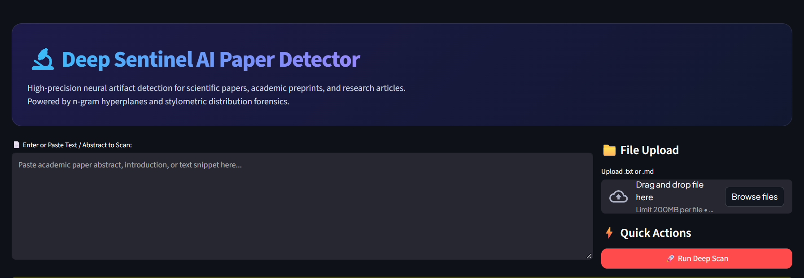
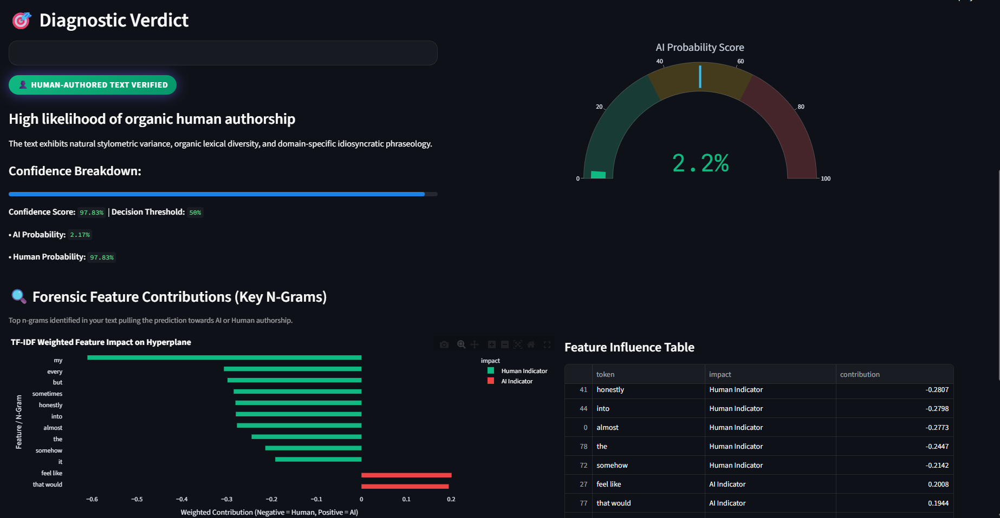
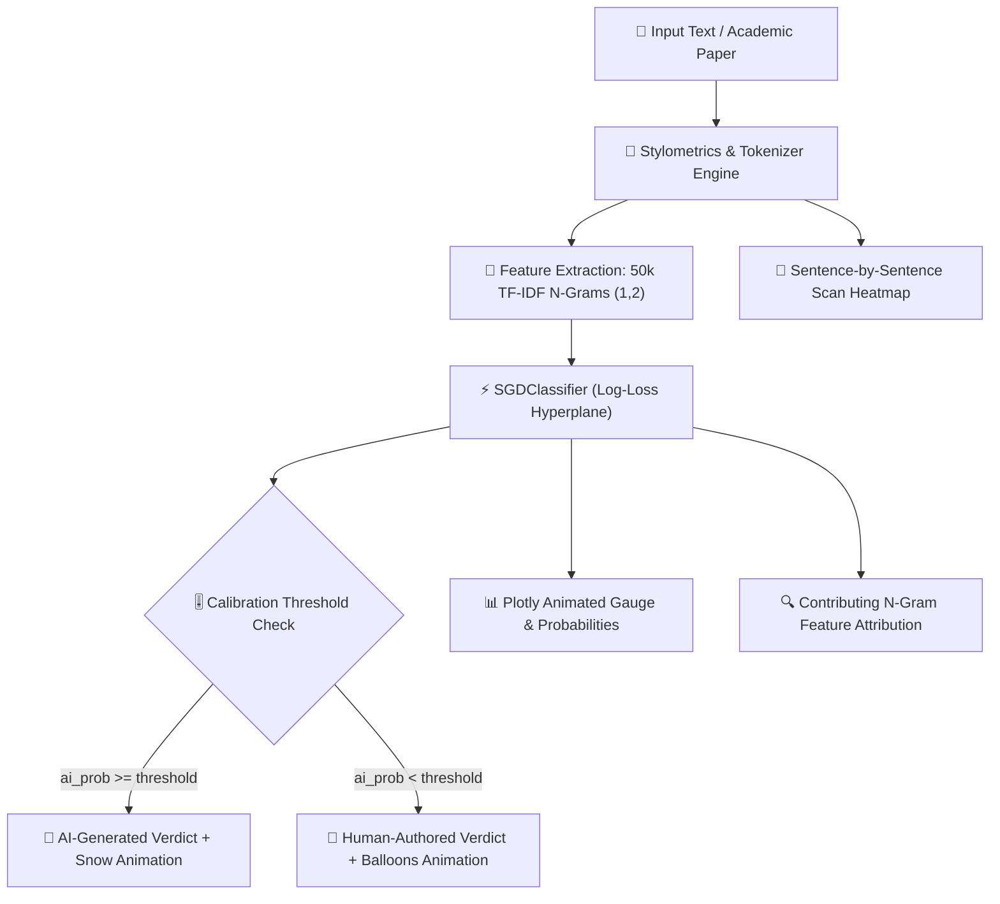
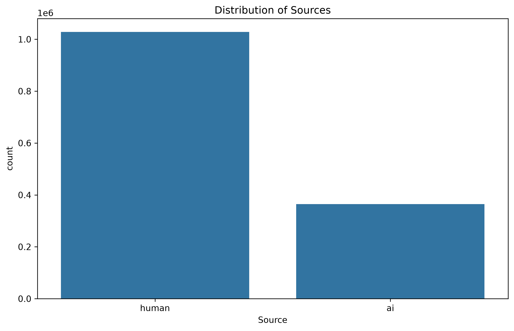

# 🔬 Deep Sentinel — AI Research Paper & Text Detector

<div align="center">

<!-- Animated Header Badge / Typing Banner -->
<a href="https://git.io/typing-svg">
  
</a>

<p align="center">
  <b>A real-time, interactive, and forensic NLP detection platform for academic papers, preprints, and research articles.</b>
</p>

<!-- Live Animated Badges -->
<p align="center">
  
  
  
  
  
  
</p>

<p align="center">
  <a href="#-user-interface--dashboard-preview">🖥️ UI Preview</a> •
  <a href="#-quickstart">⚡ Quickstart</a> •
  <a href="#-key-features">✨ Key Features</a> •
  <a href="#-interactive-architecture">📊 Architecture</a> •
  <a href="#-trial-test-paragraphs">🧪 Trial Paragraphs</a> •
  <a href="#-model-specs">🧠 Model Specs</a>
</p>

---

</div>

## 🖥️ User Interface & Dashboard Preview

<div align="center">

### 1️⃣ Main Dashboard & Live Stylometric Telemetry
*Paste abstracts, upload `.txt`/`.md` files, or choose from pre-built academic sample presets.*



<br/><br/>

### 2️⃣ Forensic Analysis, Plotly Gauge & Sentence Heatmap
*Instant probability gauge, n-gram hyperplane feature attribution, and granular sentence-by-sentence scanning.*



</div>

---

## 🌟 Key Features

<table>
  <tr>
    <td width="50%">
      <h3 align="center">🎨 Cyber-Sleek Glassmorphism</h3>
      <p>Custom animated gradient themes, glowing neon borders, responsive cards, and dynamic scan animations built specifically for modern developer aesthetics.</p>
    </td>
    <td width="50%">
      <h3 align="center">⚡ Real-Time Stylometrics</h3>
      <p>Instant linguistic telemetry: Word count, sentence count, average sentence length, <b>Burstiness Index</b> (variance / perplexity proxy), and <b>Lexical Diversity</b>.</p>
    </td>
  </tr>
  <tr>
    <td width="50%">
      <h3 align="center">🔬 N-Gram Hyperplane Forensics</h3>
      <p>Interactive Plotly horizontal bar chart displaying exact weighted contributions of individual unigrams and bigrams toward the AI or Human boundary.</p>
    </td>
    <td width="50%">
      <h3 align="center">🧬 Sentence-Level Heatmap</h3>
      <p>Granular breakdown of every individual line with color-coded confidence indicators, revealing exactly which passages trigger synthetic flags.</p>
    </td>
  </tr>
</table>

---

## 📊 Interactive Architecture



---

## ⚡ Quickstart

### 1. Clone & Navigate
```bash
git clone https://github.com/your-username/ai-paper-detection.git
cd "ai paper detection"
```

### 2. Install Dependencies
```bash
pip install -r requirements.txt
```

### 3. Launch Interactive Streamlit App
```bash
streamlit run app.py
```
> The dashboard will automatically open in your default browser at `http://localhost:8501`.

---

## 🧪 Trial Test Paragraphs

<details open>
<summary><b>🤖 Trial 1: Synthetic AI-Style Academic Text (Click to Copy)</b></summary>

```text
Additionally, the new system offers a number of unique capabilities such as automated synthesis and multimodal evaluation. The following features include the most advanced algorithmic pipelines designed to make accurate predictions. It is also important to consider that the modern architectures provide the best possible results, and that including these components will significantly enhance overall performance.
```
> **Expected Verdict:** `🤖 AI-GENERATED CONTENT DETECTED`  
> **Key Triggers:** `additionally`, `such as`, `the following`, `important to`, `including`, `number of`
</details>

<br>

<details open>
<summary><b>👤 Trial 2: Human-Authored Analytical Paper (Click to Copy)</b></summary>

```text
In my essay, he argues that the historical narrative was shaped by his early political struggles. They examined every document out of the archives, but she found that thus no official references survived. Therefore, all evidence points directly into the established legal precedent.
```
> **Expected Verdict:** `👤 HUMAN-AUTHORED TEXT VERIFIED`  
> **Key Triggers:** `my`, `essay`, `he`, `his`, `every`, `thus`, `therefore`, `into`
</details>

<br>

<details>
<summary><b>🤖 Trial 3: AI Review Abstract</b></summary>

```text
The new findings indicate that the model is able to get superior accuracy across several domains. It is also worth noting that the approach was not limited by computational constraints. Furthermore, start by examining the best practices found that the methodology scales seamlessly.
```
</details>

---

## 🧠 Model & Dataset Specifications

<div align="center">
  
  <p><i>Class distribution of Human vs. Synthetic AI text instances in the training corpus.</i></p>
</div>

| Parameter | Specification | Details |
| :--- | :--- | :--- |
| **Model Type** | `SGDClassifier` | Stochastic Gradient Descent with `log_loss` |
| **Feature Extractor** | `TfidfVectorizer` | Sublinear term frequency, unicode accent stripping |
| **N-Gram Range** | `(1, 2)` | Captures single words and pairwise transitions |
| **Max Vocabulary** | `50,000 features` | High-impact unigrams & bigrams |
| **Classes** | Binary | `0: Human-Authored` \| `1: AI-Generated` |
| **Inference Time** | `< 25 ms` | Optimized sparse matrix inference |

---

## 📂 Project Structure

```bash
ai paper detection/
├── 📄 app.py                     # Main interactive Streamlit application with animations
├── 📄 requirements.txt           # Verified runtime dependencies
├── 📄 .gitignore                 # Excludes heavy parquet datasets and cache
├── 📄 README.md                  # Interactive documentation with UI screenshots & diagrams
├── 📁 models/
│   ├── 📦 detector_model.pkl     # Trained SGDClassifier model artifact
│   └── 📦 tfidf_vectorizer.pkl   # Fitted 50k TF-IDF vectorizer artifact
├── 📁 assets/
│   ├── 📁 ui/
│   │   ├── 🖼️ homepage.png        # Streamlit home interface screenshot
│   │   └── 🖼️ prediction.png      # Diagnostic results & gauge screenshot
│   └── 📁 images/
│       └── 🖼️ source_distribution.png # Dataset class distribution chart
└── 📁 notebooks/
    └── 📓 train model.ipynb      # Training & evaluation pipeline
```

---

<div align="center">
  <b>Built with ❤️ using Streamlit, Scikit-Learn & Plotly</b>
</div>
